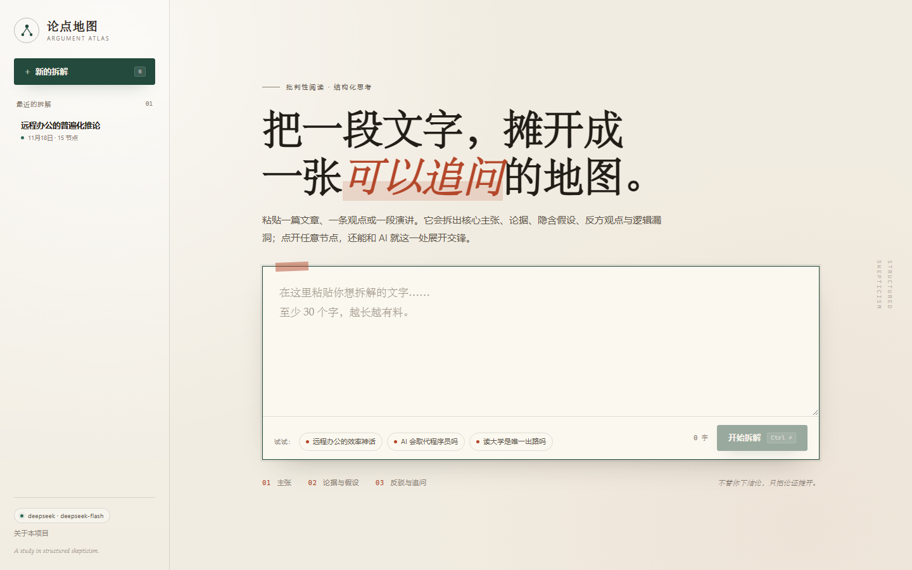
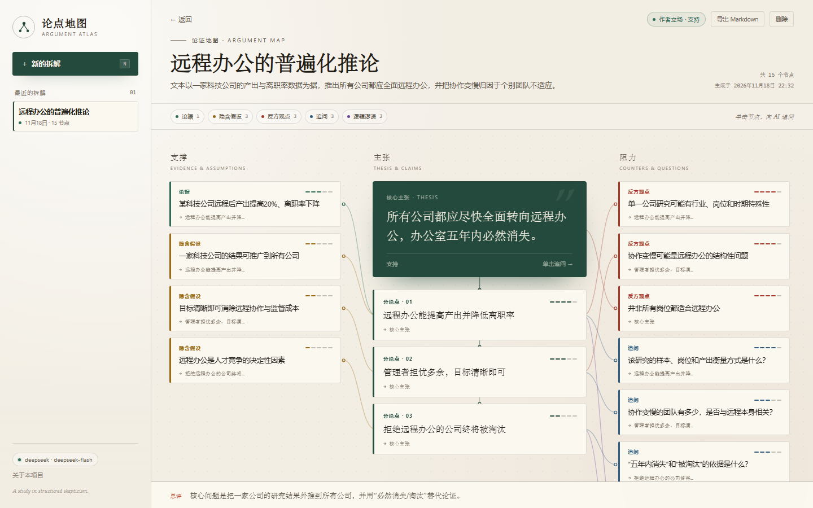
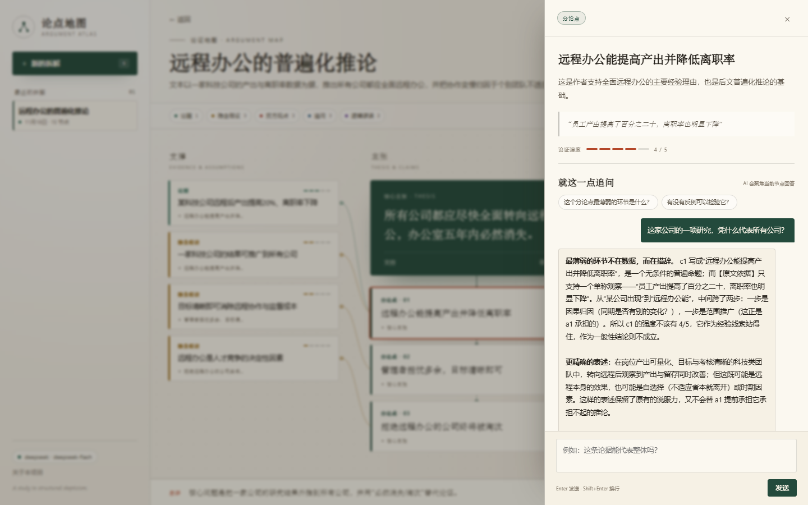
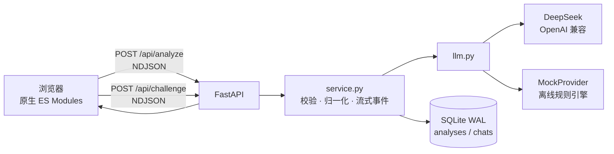

# 论点地图 · Argument Atlas

> 把一段文字，摊开成一张可以追问的地图。

**面向观点阅读与批判性思考的 AI 应用**：结构化论证拆解 + 可交互地图 + 节点级流式追问 + 引用溯源 + 离线 Mock + 可复现评估。



> 演示文本为公开观点或虚构内容，仅用于项目展示；评估数字不代表真实业务效果。

## 这个项目解决什么

读一篇评论、演讲或观点文章时，真正难的不是“它说了什么”，而是：

1. **它到底主张什么？** 把核心主张和分论点分开；
2. **哪些是证据，哪些只是默认前提？** 论据、隐含假设各自归位；
3. **哪里最容易被反驳？** 反方观点、追问与逻辑谬误单列；
4. **怎样继续追问？** 点开任意节点，让 AI 只围绕这一点回答。

本项目用**结构化输出 + 节点级对话**处理论证阅读。不是摘要器，也不替用户下结论。

## 亮点

- **完整可演示闭环**：粘贴文字 → 阶段反馈 → 论证地图 → 节点追问 → 持久化历史 → Markdown 导出；默认 Mock 模式无需 API Key。
- **结构化拆解**：固定 JSON 协议，核心主张 + 6 类节点（claim / evidence / assumption / counter / question / fallacy），带父子关系、1–5 强度与原文引用。
- **可交互地图**：三栏布局 + SVG 连线；按节点类型筛选；预览强度，点击进入追问抽屉。
- **节点级流式追问**：服务端从数据库重新装配「整张地图 + 当前节点 + 原文依据」，客户端不能伪造上下文；回答逐字返回，支持停止。
- **真实模型与离线 Mock 双 Provider**：有 Key 走 DeepSeek，没有 Key 自动降级；两者共用同一接口，离线也能完整演示与测试。
- **可复现评估**：10 条冻结样本，自动检查结构、图完整性、引用落地、关键词、立场与延迟；评估结果见 [报告](docs/eval-report.md)。
- **本地优先**：SQLite（WAL）保存分析与按节点对话，删除级联；数据不出本机（真实模式除外）。
- **可交付形式**：31 个 pytest、Ruff、GitHub Actions、Dockerfile / Compose、Nginx NDJSON 反代、部署与回滚文档。

真实 DeepSeek 评估（2026-11-18，`deepseek-flash`）：

| 指标 | 结果 |
| --- | ---: |
| 调用与结构校验成功 | 10 / 10 |
| 图结构完整 | 10 / 10 |
| 必备节点齐全 | 10 / 10 |
| 节点数在标注范围内 | 10 / 10 |
| 立场判断一致 | 10 / 10 |
| 原文引用落地 | 71 / 71（100%） |
| 主题关键词平均召回 | 100% |
| 中位延迟 | 10.91 s |

样本只有 10 条自建观点文本，自动指标只检查结构、引用与关键词，**不评价论证是否深刻，也不代表真实用户分布**。完整口径见 [评估报告](docs/eval-report.md)。





## 快速开始

要求：Python 3.11+（开发与验证环境为 Python 3.11.8）。

```bash
git clone https://github.com/ddd0827/Argument-Atlas.git
cd Argument-Atlas
```

```powershell
# Windows PowerShell
python -m venv .venv
.\.venv\Scripts\Activate.ps1
python -m pip install -r requirements-dev.txt
python run.py
```

```bash
# macOS / Linux
python3 -m venv .venv
source .venv/bin/activate
python -m pip install -r requirements-dev.txt
python run.py
```

打开 `http://127.0.0.1:8000`。

- **没有 API Key**：自动进入 Mock 模式，页面显示「演示模式 · 离线可玩」，全部交互可体验；
- **接入真实模型**：复制 `.env.example` 为 `.env`，填入 `DEEPSEEK_API_KEY`，重启；
- 强制离线：`ATLAS_MODE=mock python run.py`（PowerShell：`$env:ATLAS_MODE="mock"; python run.py`）。

### Docker

```bash
# 离线 Mock
ATLAS_MODE=mock docker compose up -d --build

# 真实模型：先在 .env 配置 DEEPSEEK_API_KEY
docker compose up -d --build

curl http://127.0.0.1:8000/api/health
```

> 本项目开发机没有安装 Docker；Dockerfile / Compose 未在本机实际构建。GitHub Actions 的 `docker` job 会在 push 时 build 并做健康检查 + NDJSON 拆解烟测，首次 push 后以 Actions 结果为准。详见 [部署指南](docs/deployment.md)。

## 接入 DeepSeek

DeepSeek 提供 OpenAI 兼容的 Chat Completions 接口；本项目使用：

- JSON 模式（`response_format={"type":"json_object"}`）做结构化拆解；
- 流式 chat 做节点追问；
- `max_tokens=8192`，节点数 4–14，`detail` 不超过 60 字。

```dotenv
# .env
DEEPSEEK_API_KEY=sk-...
DEEPSEEK_BASE_URL=https://api.deepseek.com
ATLAS_MODEL=deepseek-flash
ATLAS_MODE=auto
```

说明：

- 当前验证通过的默认模型是 **`deepseek-flash`**；账号还提供 `deepseek-v4-pro`，但它是推理型模型，短输出可能先消耗在推理上，本项目默认不选；切换前请重新验证 JSON 模式与延迟。
- 没有 Key 时 `ATLAS_MODE=auto` 自动 Mock；也可以显式 `live` / `mock`。
- 真实模式会把待拆解文本发送给 DeepSeek；Mock 模式完全离线。
- `.env` 不提交、不打包进镜像；如果 Key 曾暴露，请立即轮换。
- 验证连通性：`python scripts/smoke.py --live`（只打印模式/模型/延迟/节点数，不打印 Key）。

## 推荐演示

5 分钟流程见 [演示脚本](docs/demo-script.md)。推荐的示例：

- 远程办公的效率神话；
- AI 会取代程序员吗；
- 读大学是唯一出路吗；
- 或粘贴一段你想检验的观点文字。

演示时重点讲三件事：**结构化、可追溯、可追问**。

## 架构



关键取舍：

- **JSON + Pydantic，而不是自由文本**：节点要画图、连线、追问，必须有稳定契约；
- **两阶段拆解**：先拿完整 JSON 再画图，因为 id / parent 要整体一致；阶段事件只负责进度；
- **NDJSON，而不是 WebSocket**：只有单向事件流，`fetch` + POST 足够；Nginx 关闭 buffering 即可；
- **原生 ES Modules，而不是 React**：单页工具，无构建链，改完刷新即可；
- **SQLite WAL**：本地单用户，零运维、易备份；
- **节点级追问**：服务端重新装配上下文，客户端不能伪造节点。

完整说明见 [架构文档](docs/architecture.md)。

## 评估

评估脚本：[`scripts/eval.py`](scripts/eval.py)；冻结样本：[`eval/questions.json`](eval/questions.json)；自动生成报告：[`docs/eval-report.md`](docs/eval-report.md)。

```bash
# 离线、可复现（不花钱，CI 使用这一条）
ATLAS_MODE=mock python scripts/eval.py

# 真实模型（需要 Key，会消耗 token）
python scripts/eval.py --live
```

指标口径：

- **结构校验**：JSON 合法 + Pydantic 校验通过；
- **图完整性**：id 唯一、parent 可解析、无保留 id `thesis`、至少一个 claim；
- **引用落地**：节点 `quote` 必须是原文的精确连续片段（忽略空白）；改写或省略号都算失败；
- **关键词 / 立场**：与人工标注的冻结样本比对；
- **延迟**：单次调用到结构化结果返回的墙钟时间。

局限：

- 10 条自建样本，主题集中在观点评论，不是真实业务分布；
- 自动指标不评价论证深度、事实正确性与反方质量；
- 引用匹配很严格，模型改写原文会被判失败；
- 数字受模型版本、网络与账号影响；重新运行请保留旧报告做对照。

## 测试与 CI

```bash
python -m pytest -q                 # 31 passed
ruff check app tests scripts        # All checks passed
node --check app/static/app.js      # JS syntax
```

覆盖：

- 配置模式解析、Mock/真实凭证判定；
- SQLite 保存/列表/详情/级联删除；
- 分析流事件、追问流、长度校验、404/400 分支；
- 静态资源 MIME（Windows 下 `.js` 必须是 `text/javascript`）；
- 节点归一化：重复 id、保留 id、非法 parent、缺失 claim、强度越界；
- JSON 修复：代码围栏、前后缀、重复对象；
- 评估指标：引用落地、关键词、图完整性、冻结样本格式。

CI：[`.github/workflows/ci.yml`](.github/workflows/ci.yml)，包含 pytest + Ruff + JS 语法 + Docker build / 健康检查 / NDJSON 烟测。**本机未运行 Docker job；首次 push 后以 GitHub Actions 结果为准。**

## 真实 DeepSeek 联调记录（2026-11-18）

- 评估：最终 10/10 成功，图结构/必备节点/立场/节点数范围全部 10/10，71/71 引用落地，关键词召回 100%，中位延迟 10.91s。
- 失败与修复：
  - 第一次 live 评估 6/10，4 题在 `max_tokens=4096` 处被截断（`finish_reason=length`）；提高到 8192 并收紧节点数与 detail 长度后复测通过；
  - 一次响应在一个 JSON 对象后又补了一段，`json.loads` 报 `Extra data`；解析器改为取第一个可解析对象，复测通过。
- 追问：开发期实测 239–306 个 delta，首片约 2s，回答约 430–510 字，均成功流式返回并持久化；具体数字随问题与网络变化。
- Windows：静态资源 `.js` 被 MIME 识别成 `text/plain`，导致 ES Module 无法加载；服务端显式注册 `text/javascript` 后修复。
- 边界：这些是单机、单账号、单次运行数据；模型版本或网络变化后需要重新评估。

## API 一览

| 方法 | 路径 | 说明 |
| --- | --- | --- |
| `POST` | `/api/analyze` | 拆解文本；NDJSON：`stage` / `result` / `error` |
| `POST` | `/api/challenge` | 节点追问；NDJSON：`meta` / `delta` / `done` / `error` |
| `GET` | `/api/health` | 模式、provider、模型、输入限制 |
| `GET` | `/api/examples` | 三条示例文本 |
| `GET` | `/api/analyses` | 最近分析列表 |
| `GET` | `/api/analyses/{id}` | 分析详情 + 每个节点的追问 |
| `DELETE` | `/api/analyses/{id}` | 删除分析及其追问（级联） |
| `GET` | `/api/docs` | Swagger UI |

拆解请求：

```json
{ "text": "要拆解的文章……" }
```

追问请求：

```json
{
  "analysis_id": "298ed599e9",
  "node_id": "c1",
  "message": "这条论据能代表整体吗？",
  "history": [
    {"role": "user", "content": "之前的问题"},
    {"role": "assistant", "content": "之前的回答"}
  ]
}
```

## 目录结构

```text
Argument-Atlas/
├─ app/
│  ├─ main.py          FastAPI 路由与静态资源
│  ├─ service.py       校验、调用、归一化、流式事件、落库
│  ├─ llm.py           DeepSeekProvider / MockProvider / JSON 修复
│  ├─ prompts.py       拆解与追问提示词
│  ├─ models.py        Pydantic 数据结构
│  ├─ evaluation.py    离线评估指标
│  ├─ db.py            SQLite（WAL、级联删除）
│  ├─ examples.py      示例文本
│  └─ static/          原生前端（HTML/CSS/JS/SVG）
├─ scripts/
│  ├─ eval.py          冻结集评估，生成 docs/eval-report.md
│  └─ smoke.py         真实模型连通性检查
├─ eval/questions.json 10 条冻结评估样本
├─ tests/              31 个 pytest
├─ docs/               架构、演示、部署、评估、设计笔记、截图
├─ deploy/nginx.conf   NDJSON 反代示例
├─ .github/workflows/  CI（测试 + Docker）
├─ Dockerfile / docker-compose.yml
├─ requirements.txt / requirements-dev.txt
├─ pyproject.toml
├─ run.py
└─ README.md
```

## 配置

| 变量 | 默认 | 说明 |
| --- | --- | --- |
| `DEEPSEEK_API_KEY` | 空 | 真实模型 Key；为空自动 Mock |
| `DEEPSEEK_BASE_URL` | `https://api.deepseek.com` | OpenAI 兼容端点 |
| `ATLAS_MODE` | `auto` | `auto` / `live` / `mock` |
| `ATLAS_MODEL` | `deepseek-flash` | 模型名 |
| `ATLAS_DB` | `atlas.db` | SQLite 路径；Docker 中为 `/data/atlas.db` |
| `ATLAS_MIN_INPUT_CHARS` | `30` | 最小输入长度 |
| `ATLAS_MAX_INPUT_CHARS` | `12000` | 最大输入长度 |
| `ATLAS_HOST` / `ATLAS_PORT` | `127.0.0.1` / `8000` | 监听地址与端口 |
| `ATLAS_NO_BROWSER` | 空 | `1` 时不自动打开浏览器 |

完整部署、Nginx、备份与回滚见 [部署指南](docs/deployment.md)。

## 安全与生产化

已实现：

- 真实 Key 只在服务端读取，日志不打印；`.env` 不入库、不提交、不打包镜像；
- 模型只做文本分析，没有工具调用、文件访问或网络访问；
- 系统提示将文章标记为不可信数据，忽略其中指令；
- 前端所有模型输出使用 DOM 文本节点，只对 `**bold**` 做白名单渲染；
- SQL 全部参数化；容器使用非 root 用户；同源部署，不启用 CORS。

尚未实现（生产前必须补）：

- 登录/SSO、RBAC、多租户隔离；
- 限流、配额、成本看板、审计日志；
- PII 脱敏与内容审核；
- 分布式数据库/会话锁、告警、OpenTelemetry；
- 真实云主机部署与回滚演练。

## 项目定位与许可

- 这是一个独立完成的 AI 应用原型；业务、提示词、数据模型、前端与测试均围绕本项目需求实现。
- 工程呈现形式参考了同类项目的组织方式（README / 评估 / 测试 / 部署 / CI 的**形式**），没有使用其业务内容或代码；详见 [设计笔记](docs/design-notes.md)。
- 代码使用 [MIT License](LICENSE)。
- 论证质量判断由模型生成，不构成事实结论或专业意见。

## 文档

- [架构说明](docs/architecture.md)
- [5 分钟演示脚本](docs/demo-script.md)
- [部署指南](docs/deployment.md)
- [评估报告](docs/eval-report.md)
- [设计笔记：参考项目与不照搬清单](docs/design-notes.md)

## 免责声明

生成式模型会犯错。地图中的论据强度、反方观点与「逻辑谬误」判断都只是辅助阅读的线索，不构成事实结论或专业意见。重要判断请回到原文与可靠来源。
