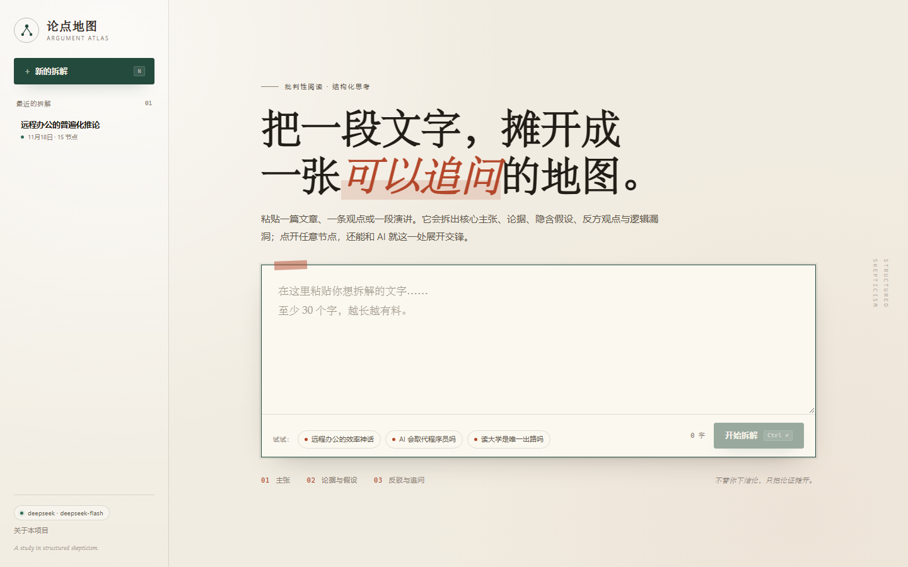
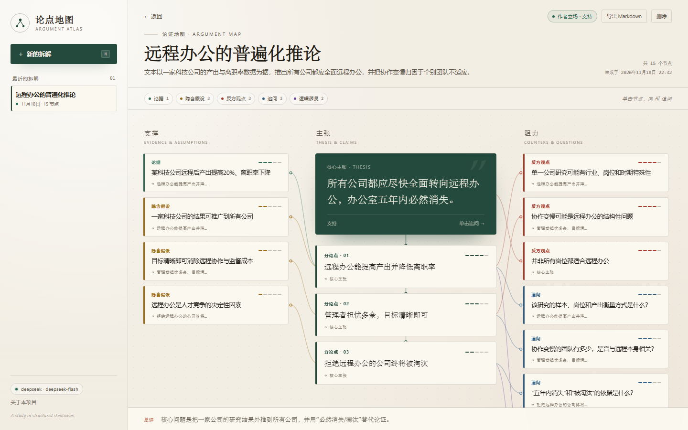
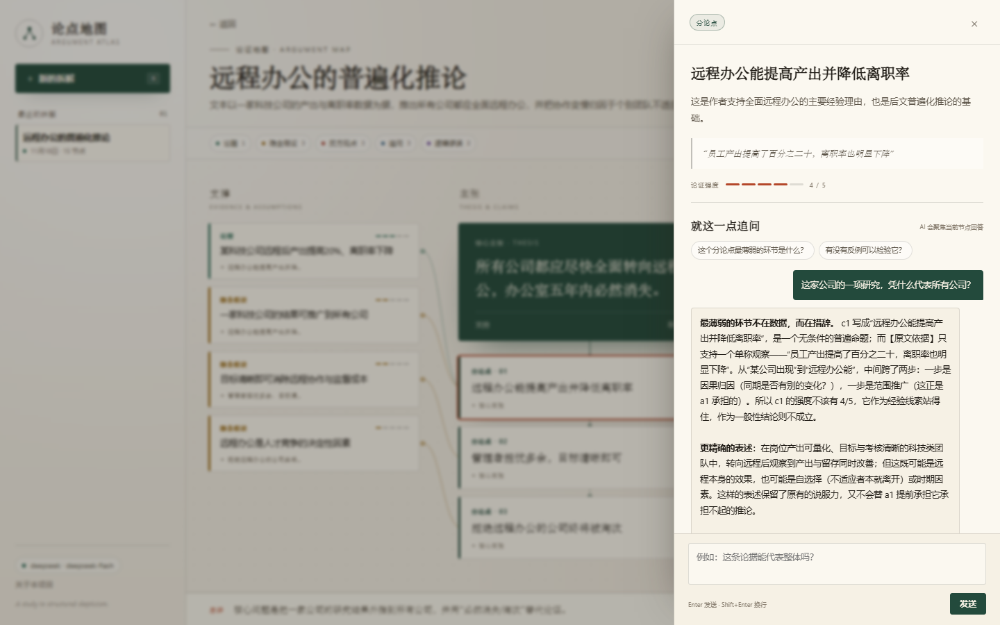

# 5 分钟演示脚本

目标是让观众在 5 分钟内看懂：**输入一段文字 → 得到一张论证地图 → 对某个节点继续追问**，并且能区分真实模型与离线演示。

## 0. 演示前检查

```bash
cd Argument-Atlas
.venv\Scripts\activate        # Windows
# source .venv/bin/activate    # macOS / Linux

# 可选：强制离线，保证演示稳定、不花 token
# PowerShell: $env:ATLAS_MODE="mock"; python run.py
# bash:       ATLAS_MODE=mock python run.py
python run.py
```

打开 `http://127.0.0.1:8000`。左下角徽标会显示当前模式：

- `deepseek · deepseek-flash`：真实模型；
- `演示模式 · 离线可玩`：离线 Mock。



## 1. 输入与拆解（约 60 秒）

1. 点击示例「远程办公的效率神话」，或粘贴一段 30–200 字的观点文字；
2. 点击「开始拆解」（`Ctrl + Enter` / macOS `Cmd + Enter`）；
3. 观察三个阶段：通读 → 拆解 → 编织；
4. Mock 模式约 1.5 秒，真实模型通常 10–20 秒，偶发 20 秒以上。

讲解点：

> 拆解不是流式吐字，而是先拿到完整 JSON，再做校验和图结构修复。因为节点之间要互相引用，id 和 parent 必须整体一致。

## 2. 阅读地图（约 60 秒）



按三栏讲：

- **中间**：核心主张 + 分论点；
- **左侧**：论据与隐含假设；
- **右侧**：反方观点、追问、逻辑谬误；
- 卡片右上角是 1–5 的论证强度；底部小字是父节点；
- 顶部胶囊可以按类型筛选（论据/假设/反驳/追问/谬误）。

可以指出：

- 主张、证据、假设不是模型“自由发挥”，它们都受 JSON 协议约束；
- 原文引用会显示在节点抽屉里，方便核对；
- 设计上刻意不替用户下结论，只把结构摊开。

## 3. 节点级追问（约 90 秒）



1. 单击某个「论据」或「隐含假设」卡片；
2. 右侧抽屉显示：节点内容、说明、原文依据、强度；
3. 点一个快捷问题，例如「这条论据能代表整体吗？」；
4. 观察回答逐字出现；可以点「停止」中断；
5. 关闭抽屉再打开，追问记录仍在（SQLite 持久化）。

讲解点：

> 追问不是把整篇文章再发给模型，而是由服务端按 `analysis_id + node_id` 重新装配上下文：整张地图、当前节点、原文引用、最近对话。客户端不能伪造节点。

## 4. 历史、深链与导出（约 60 秒）

- 左侧「最近的拆解」重新打开历史；
- 地址栏会变成 `/?id=...`，打开节点后会带 `&node=c1`；
- 刷新页面仍能恢复地图与抽屉；
- 右上角「导出 Markdown」得到一份可存档的复盘；
- 「删除」会级联删除该分析下的追问。

## 5. 工程与评估（约 60 秒）

```bash
python -m pytest -q                 # 31 passed
ruff check app tests scripts        # All checks passed

# 离线评估（不花钱）
python scripts/eval.py --mock

# 真实评估（会消耗 token）
python scripts/eval.py --live
```

打开 [评估报告](eval-report.md)：

- 10 条冻结样本；
- 10/10 结构校验成功，10/10 图结构完整；
- 71/71 原文引用可回溯（100%）；
- 主题关键词与立场各 100%；
- 中位延迟约 10.9 秒。

强调局限：

> 这是 10 条自建观点文本，不是真实业务分布；自动指标只检查结构、引用和关键词，不评价论证是否深刻。

## 6. 真实模型下的 10 项人工检查

1. 左下角显示 `deepseek · deepseek-flash`；
2. 三个 stage 事件按顺序出现；
3. 地图节点数在 4–14 之间；
4. 抽查 3 个 `quote`，能在原文中找到；
5. 点击一个节点，回答确实围绕该节点，而不是复述全文；
6. 「停止」能中断流式回答；
7. 关闭再打开节点，追问记录还在；
8. 刷新页面，`?id` / `?node` 深链仍能恢复；
9. 导出 Markdown 包含核心主张、分论点、反驳与总评；
10. 故意输入一段很短的文字，界面给出可读错误而不是崩溃。

## 7. 如果真实 API 不可用

切到 Mock：

```bash
# PowerShell
$env:ATLAS_MODE="mock"; python run.py
# bash
ATLAS_MODE=mock python run.py
```

Mock 会生成确定性的演示地图和追问，适合展示交互，但**不代表模型能力**。演示时明确说明这一点。

## 8. 诚实边界

- 这是个人作品集/学习项目，不是生产客服系统；
- 语料与示例是虚构或公开观点，评估数字只做方向性参考；
- 当前没有登录、多租户、限流与审计；
- 真实模式会把待分析文本发送给 DeepSeek，不要粘贴敏感内容。
